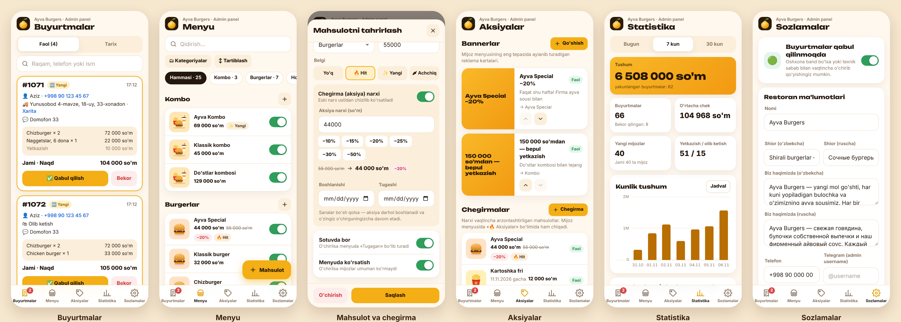

# 🍔 Ayva Burgers — Telegram yetkazib berish boti

Telegram bot, Mini App (bot ichida ochiladigan menyu) va admin panel. Mijoz rasmli menyudan taom tanlaydi,
savatga soladi, manzil va lokatsiyani belgilaydi, buyurtma beradi. Buyurtma darhol xodimlar guruhiga va
admin panelga tushadi. Restoran egasi menyu, narx, rasm, aksiya va sozlamalarni panelning o'zidan boshqaradi —
dasturchi kerak emas.




## Imkoniyatlar

**Mijoz uchun (o'zbekcha / ruscha)**
- `/start` → til tanlash → telefon raqamni yuborish → bosh menyu
- Mini App: aksiya bannerlari, «🔥 Aksiyalar» bo'limi, kategoriyalar, rasmli kartalar, chegirma narxlari
  (eski narx chizilgan), «Hit / Yangi / Achchiq» belgilari, savat
- Bepul yetkazishgacha qolgan summa ko'rsatkichi, sous/ichimlik takliflari
- Yetkazib berish yoki olib ketish, manzil + xaritada lokatsiya (GPS yoki qo'lda)
- To'lov: naqd pul (Click va Payme «Tez orada»)
- Ish vaqtidan tashqari yoki admin to'xtatganda buyurtma qabul qilinmaydi (menyuni ko'rish mumkin)
- «📦 Buyurtmalarim», «ℹ️ Biz haqimizda», «📞 Aloqa», «⚙️ Sozlamalar»

**Admin panel** (botda `/panel` yoki «🛠 Admin panel» tugmasi)
- 📋 **Buyurtmalar** — faol buyurtmalar, bir tugma bilan holat o'zgartirish, tarix, raqam/telefon bo'yicha qidiruv.
  Yangi buyurtma kelsa panel o'zi xabar beradi
- 🍔 **Menyu** — mahsulot qo'shish/tahrirlash/o'chirish: rasm (telefondan yuklanadi, avtomatik kichraytiriladi),
  nomi va tarkibi (uz/ru), narx, kategoriya, belgi. «Sotuvda bor» (stop-list) va «Menyuda ko'rsatish» o'tkazgichlari,
  tartibni o'zgartirish. Kategoriyalarni qo'shish, nomlash, rasmini tanlash, yashirish
- 🔥 **Aksiyalar** — chegirma narxi (sana bilan yoki muddatsiz, −10/−20/−30% tugmalari),
  menyu tepasida aylanadigan bannerlar (rasm yoki sarlavha, bosilganda mahsulot yoki kategoriyani ochadi)
- 📊 **Statistika** — bugun / 7 / 30 kun: tushum, buyurtmalar, o'rtacha chek, yangi mijozlar,
  kunlik tushum grafigi, soatlar bo'yicha yuklama, eng ko'p sotilgan mahsulotlar
- ⚙️ **Sozlamalar** — buyurtmalarni vaqtincha to'xtatish, restoran ma'lumotlari, manzil va lokatsiya, ish vaqti,
  yetkazish narxi, bepul yetkazish chegarasi, minimal buyurtma, to'lov turlari, adminlar ro'yxati,
  mijozlarga xabar (rasm + matn + «Menyuni ochish» tugmasi)
- Telefonda Telegram ichida ochiladi; kompyuterda — bot beradigan bir martalik havola orqali (parolsiz)

**Xodimlar guruhi**
- Har bir buyurtma: mijoz, telefon, manzil, xarita havolasi, mahsulotlar, summa
- Tugmalar: ✅ Qabul qilish → 🚗 Yo'lga chiqdi / 🛍 Tayyor → 🏁 Yakunlash, ❌ Bekor qilish
  (panel bilan sinxron — qayerda bosilsa ham ikkalasida yangilanadi)
- `/active`, `/stats`, `/stoplist`, `/broadcast`, `/panel`, `/id`

**Xavfsizlik va tezlik**
- Narxlar faqat serverda hisoblanadi (aksiya narxi ham) — mijoz narxni o'zgartira olmaydi
- Mini App va panel so'rovlari Telegram imzosi (`initData`) bilan tekshiriladi; kompyuterdagi kirish —
  imzolangan cookie (7 kun), bir martalik havola 10 daqiqa amal qiladi
- Panelga faqat egalar (`ADMIN_IDS`) va ular qo'shgan adminlar kira oladi
- Asinxron server (aiohttp + aiogram 3, webhook): 200–300 ta bir vaqtdagi mijoz uchun bemalol yetadi

## Tuzilishi

```
bot/              Python server
  handlers/       bot: mijoz (user.py) va admin (admin.py)
  admin_api.py    admin panel API (/api/admin/*), rasm yuklash, kirish
  web.py          Mini App API (/api/bootstrap, /api/order)
  catalog.py      menyu, aksiya narxlari, ish vaqti, narx hisoblash
  db.py           SQLite: buyurtmalar, mijozlar, menyu, bannerlar, sozlamalar, adminlar
  orders.py       buyurtma xabarlari va holatlari
  seed.py         birinchi ishga tushishda data/*.json → baza
webapp/           Mini App (index.html, app.js, styles.css, rasmlar)
webapp/admin/     admin panel (index.html, admin.js, admin.css)
data/             menu.json, store.json — faqat birinchi ishga tushish uchun namuna
tests/            avtomatik testlar
```

## 1. Telegram'da tayyorgarlik (5 daqiqa)

1. [@BotFather](https://t.me/BotFather) → `/newbot` → nom: `Ayva Burgers`, username masalan `ayvaburgers_bot`.
   Berilgan **tokenni** saqlang.
2. BotFather'da: `/setuserpic` (logo), `/setdescription`, `/setabouttext`.
3. Xodimlar uchun Telegram **guruh** oching (masalan «Ayva — Buyurtmalar»), botni qo'shing va
   **admin** qiling.
4. Bot ishga tushgach:
   - guruhda `/id` yozing → chiqqan raqam `ADMIN_CHAT_ID` bo'ladi;
   - botga shaxsiy `/id` yozing → sizning ID'ingiz `ADMIN_IDS` bo'ladi (panel egasi).
   Ikkalasini server sozlamalariga qo'yib, qayta ishga tushiring.
5. Botga `/panel` yozing — admin panel ochiladi. Boshqa xodimlarni panel → Sozlamalar → Adminlar orqali qo'shasiz.

## 2. Serverga joylash

### A variant — Railway (tavsiya: eng tez va oson, ~5$/oy)

1. Bu repozitoriyni GitHub'ga yuklang.
2. [railway.com](https://railway.com) → **New Project → Deploy from GitHub repo** → shu repo.
3. Servis **Settings → Networking → Generate Domain** (https manzil beriladi, `PUBLIC_URL` avtomatik olinadi).
4. **Variables**: `BOT_TOKEN`, `ADMIN_CHAT_ID`, `ADMIN_IDS` (xohlasangiz `ADMIN_LANG=ru`).
5. **Volume** qo'shing, mount path: `/data` — **majburiy**: buyurtmalar, menyu va yuklangan rasmlar shu yerda
   saqlanadi. Volume bo'lmasa, har deployda hammasi o'chib ketadi.
6. Deploy tugagach botga `/start` yozing.

### B variant — o'z VPS'ingiz (Docker + avtomatik HTTPS)

Kerak: VPS (Ubuntu, 1 GB RAM yetadi), domen (masalan `menu.ayvaburgers.uz`) — uning A-yozuvi VPS IP'siga.

```bash
git clone <repo> ayva && cd ayva
cp .env.example .env      # BOT_TOKEN, ADMIN_CHAT_ID, ADMIN_IDS, DOMAIN ni to'ldiring
docker compose up -d --build
docker compose logs -f bot
```

Baza va rasmlar `ayva-data` docker volume'ida saqlanadi.

### Kompyuterda sinash

```bash
python -m venv .venv && . .venv/bin/activate
pip install -r requirements-dev.txt
cp .env.example .env      # BOT_TOKEN ni yozing

# Faqat dizaynni ko'rish (Telegram'siz): http://localhost:8080 va http://localhost:8080/admin/
BOT_MODE=web DEV_MODE=1 python -m bot

# Botni to'liq sinash uchun https tunnel kerak (Mini App faqat https'da ochiladi):
#   cloudflared tunnel --url http://localhost:8080   → berilgan https manzilni PUBLIC_URL ga yozing
python -m bot

pytest -q                 # testlar
```

`DEV_MODE=1` da panel parolsiz ochiladi — serverda **hech qachon** yoqmang.

## 3. Menyu va ma'lumotlar

Hammasi admin paneldan o'zgartiriladi, serverni qayta ishga tushirish kerak emas — o'zgarish mijozlarda darhol ko'rinadi.

- `data/menu.json` va `data/store.json` faqat **birinchi** ishga tushishda bazaga namuna sifatida yuklanadi.
  Keyin ular o'qilmaydi, menyu bazada saqlanadi.
- Mahsulot rasmlari: telefondan yoki kompyuterdan yuklang (JPG/PNG/WebP, 12 MB gacha). Server ularni
  1200 px gacha kichraytirib, WebP'ga o'giradi. Rasm bo'lmasa kategoriyaning chizilgan rasmi chiqadi.
- **Logo va ranglar**: logo — `webapp/img/logo.svg`; asosiy rang — `webapp/styles.css` boshidagi `--accent`.

## 4. Click va Payme (keyingi bosqich)

Hozir ular Mini App va panelda «Tez orada» bo'lib turibdi va yoqib bo'lmaydi. Ulash uchun Click/Payme bilan
shartnoma tuziladi va @BotFather → Payments bo'limidan provayder tokeni olinadi. Shundan so'ng to'lov
Telegram ichida (`openInvoice`) bo'ladi — buning uchun to'lov kodi qo'shiladi.
