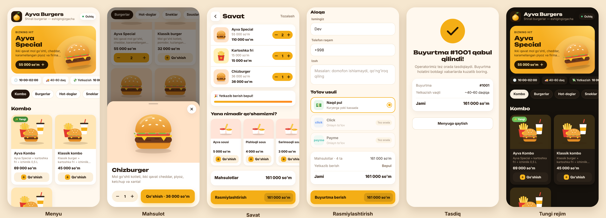

# 🍔 Ayva Burgers — Telegram yetkazib berish boti

Telegram bot + Mini App (bot ichida ochiladigan menyu sahifasi). Mijoz rasmli menyudan taom tanlaydi,
savatga soladi, manzil va lokatsiyani belgilaydi, buyurtma beradi. Buyurtma darhol xodimlar guruhiga
tushadi, xodimlar tugmalar bilan holatini o'zgartiradi, mijozga esa har bir holat haqida xabar boradi.



## Imkoniyatlar

**Mijoz uchun (o'zbekcha / ruscha)**
- `/start` → til tanlash → telefon raqamni yuborish → bosh menyu
- Mini App: kategoriyalar, rasmli kartalar, «Hit / Yangi / Achchiq» belgilari, mahsulot oynasi, savat
- Bepul yetkazishgacha qolgan summa ko'rsatkichi, sous/ichimlik takliflari
- Yetkazib berish yoki olib ketish, manzil + xaritada lokatsiya (GPS yoki qo'lda)
- To'lov: naqd pul (Click va Payme «Tez orada» bo'lib turibdi)
- Ish vaqtidan tashqari buyurtma qabul qilinmaydi (menyuni ko'rish mumkin)
- «📦 Buyurtmalarim», «ℹ️ Biz haqimizda», «📞 Aloqa», «⚙️ Sozlamalar»
- Telegram'ning yorug' va tungi mavzusiga moslashadi

**Xodimlar uchun (admin guruhi)**
- Har bir buyurtma: mijoz, telefon, manzil, Yandex/Google xarita havolasi, mahsulotlar, summa
- Tugmalar: ✅ Qabul qilish → 🚗 Yo'lga chiqdi / 🛍 Tayyor → 🏁 Yakunlash, ❌ Bekor qilish (tasdiq bilan)
- `/active` — faol buyurtmalar, `/stats` — bugun va 7 kunlik statistika
- `/stoplist` — tugagan mahsulotni bir tugma bilan o'chirish/yoqish
- `/reload` — `menu.json` va `store.json` ni serverni to'xtatmasdan qayta o'qish
- `/broadcast` — reklama xabarini hamma mijozlarga yuborish (xabarga reply qilib)

**Xavfsizlik va tezlik**
- Narxlar faqat serverda hisoblanadi — mijoz narxni o'zgartira olmaydi
- Mini App so'rovlari Telegram imzosi (`initData`) bilan tekshiriladi
- Bitta mijoz 15 soniyada bittadan ortiq buyurtma bera olmaydi
- Asinxron server (aiohttp + aiogram 3, webhook): 200–300 ta bir vaqtdagi mijoz uchun bemalol yetadi

## Tuzilishi

```
bot/            Python server: bot + Mini App API
  handlers/     mijoz (user.py) va admin (admin.py) handlerlari
  catalog.py    menyu, narx hisoblash, ish vaqti
  orders.py     buyurtma xabarlari va holatlari
  web.py        Mini App API (/api/bootstrap, /api/order)
  texts.py      bot matnlari (uz/ru)
webapp/         Mini App: index.html, styles.css, app.js, rasmlar
data/
  menu.json     MENYU — kategoriyalar, mahsulotlar, narxlar
  store.json    Do'kon: manzil, telefon, ish vaqti, yetkazish narxi, to'lov turlari
tests/          avtomatik testlar
```

## 1. Telegram'da tayyorgarlik (5 daqiqa)

1. [@BotFather](https://t.me/BotFather) → `/newbot` → nom: `Ayva Burgers`, username masalan `ayvaburgers_bot`.
   Berilgan **tokenni** saqlang.
2. BotFather'da: `/setuserpic` (logo), `/setdescription`, `/setabouttext`.
3. Xodimlar uchun Telegram **guruh** oching (masalan «Ayva — Buyurtmalar»), botni qo'shing va
   **admin** qiling (shunda bot guruhdagi buyruqlarni ko'radi).
4. Bot ishga tushgach, guruhda `/id` yozing — chiqqan raqamni `ADMIN_CHAT_ID` ga qo'ying.

## 2. Serverga joylash

### A variant — Railway (tavsiya: eng tez va oson, ~5$/oy)

1. Bu repozitoriyni GitHub'ga yuklang.
2. [railway.com](https://railway.com) → **New Project → Deploy from GitHub repo** → shu repo.
3. Servis **Settings → Networking → Generate Domain** (https manzil beriladi, `PUBLIC_URL` avtomatik olinadi).
4. **Variables**: `BOT_TOKEN`, `ADMIN_CHAT_ID` (va xohlasangiz `ADMIN_IDS`, `ADMIN_LANG`).
5. **Volume** qo'shing, mount path: `/data` — buyurtmalar bazasi qayta deployda o'chib ketmasligi uchun.
6. Deploy tugagach botga `/start` yozing.

Menyuni o'zgartirish: `data/menu.json` ni tahrirlab GitHub'ga push qiling — Railway o'zi qayta joylaydi.

### B variant — o'z VPS'ingiz (Docker + avtomatik HTTPS)

Kerak: VPS (Ubuntu, 1 GB RAM yetadi), domen (masalan `menu.ayvaburgers.uz`) — uning A-yozuvi VPS IP'siga.

```bash
git clone <repo> ayva && cd ayva
cp .env.example .env      # BOT_TOKEN, ADMIN_CHAT_ID, DOMAIN ni to'ldiring
docker compose up -d --build
docker compose logs -f bot
```

Menyuni o'zgartirish: `data/menu.json` ni tahrirlang va guruhda `/reload` yozing (qayta ishga tushirish shart emas).

### Kompyuterda sinash

```bash
python -m venv .venv && . .venv/bin/activate
pip install -r requirements-dev.txt
cp .env.example .env      # BOT_TOKEN ni yozing

# Faqat dizaynni ko'rish (Telegram'siz): http://localhost:8080
BOT_MODE=web DEV_MODE=1 python -m bot

# Botni to'liq sinash uchun https tunnel kerak (Mini App faqat https'da ochiladi):
#   cloudflared tunnel --url http://localhost:8080   → berilgan https manzilni PUBLIC_URL ga yozing
python -m bot

pytest -q                 # testlar
```

## 3. Menyu va ma'lumotlarni o'zgartirish

**`data/menu.json`** — har bir mahsulot:

```jsonc
{
  "id": "classic",                       // lotincha, takrorlanmas, keyin o'zgartirmang
  "category": "burgers",                 // categories ichidagi id
  "price": 32000,                        // so'mda, butun son
  "badge": "hit",                        // hit | new | spicy | ""
  "image": "img/products/classic.jpg",   // bo'sh bo'lsa kategoriya rasmi chiqadi
  "name": { "uz": "Klassik burger", "ru": "Классический бургер" },
  "description": { "uz": "...", "ru": "..." }
}
```

Mahsulot rasmlari: kvadrat yoki 4:3, ~800 px, JPG/WebP — `webapp/img/products/` papkasiga qo'ying.

**`data/store.json`** — nom, shior, manzil, telefon, Telegram/Instagram, xaritadagi joylashuv,
ish vaqti (`"open": "10:00", "close": "02:00"` — yarim tundan o'tishi mumkin), yetkazish narxi
(`fee`), bepul yetkazish chegarasi (`free_from`), minimal buyurtma (`min_order`), to'lov turlari.

**Logo va ranglar**: logo — `webapp/img/logo.svg`; asosiy rang — `webapp/styles.css` boshidagi `--accent`.

## 4. Click va Payme (keyingi bosqich)

Hozir ular Mini App'da «Tez orada» bo'lib turibdi. Ulash uchun Click/Payme bilan shartnoma tuziladi va
@BotFather → Payments bo'limidan provayder tokeni olinadi. Shundan so'ng to'lov Telegram ichida
(`openInvoice`) bo'ladi. Bu uchun to'lov kodi qo'shiladi — faqat `store.json` da `"click": true`
qilib qo'yish yetarli emas (u holda pul olinmaydi).

**Lokatsiya**: `store.json` dagi `"location": null` o'rniga restoran koordinatalarini yozing,
masalan `{ "lat": 41.3110, "lon": 69.2405 }` — «Biz haqimizda» bo'limida xarita pini chiqadi.
